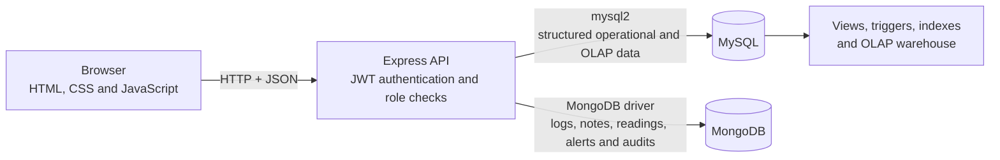
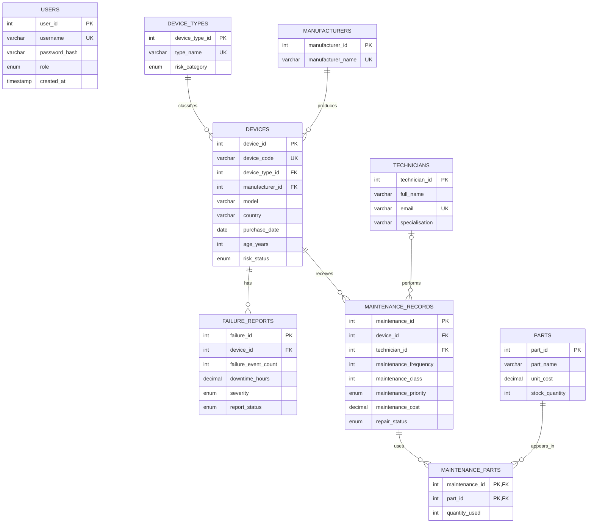
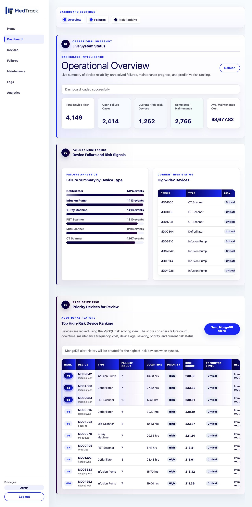
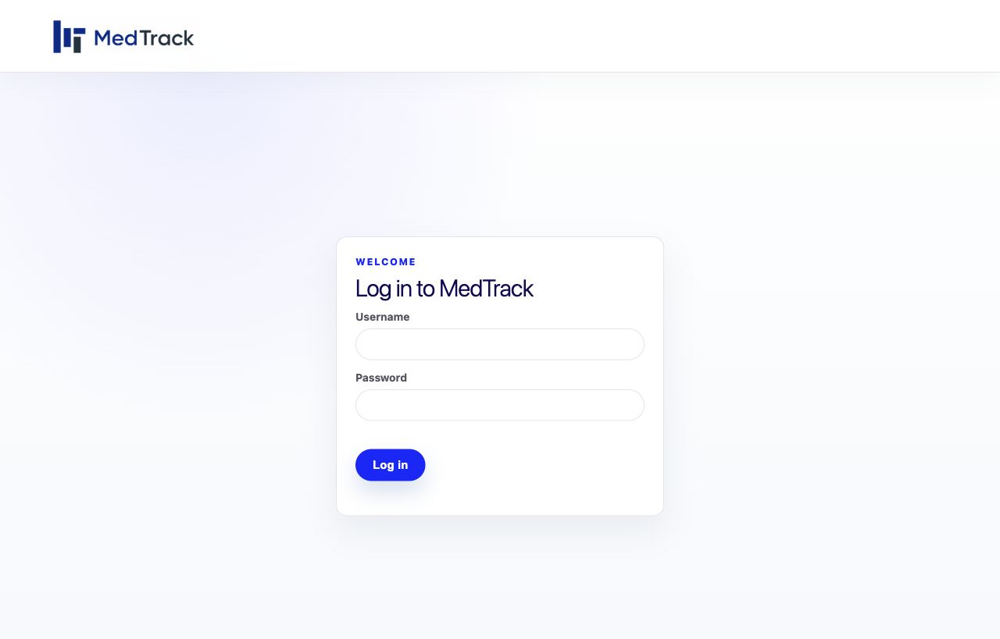
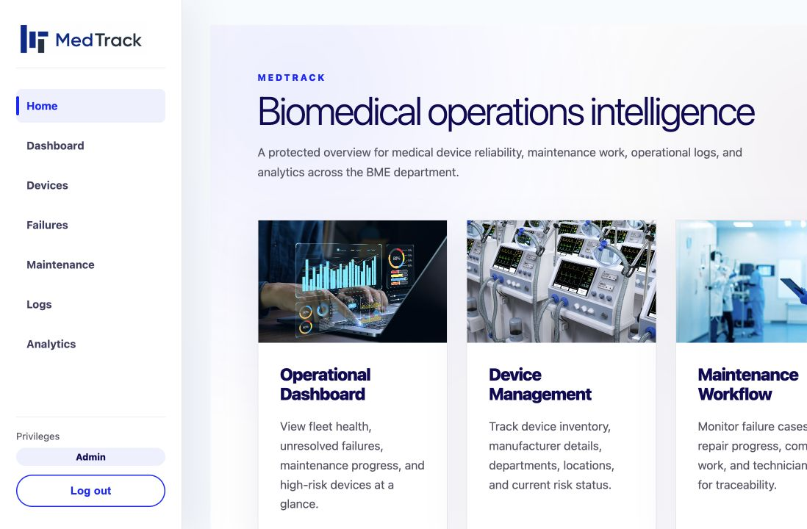
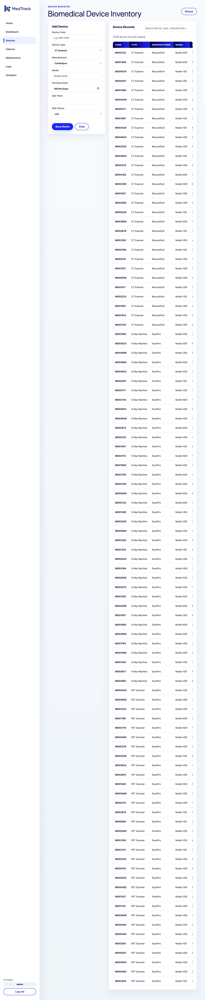
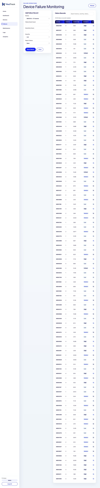
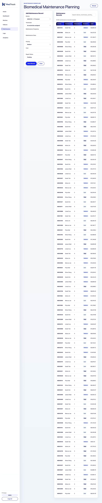
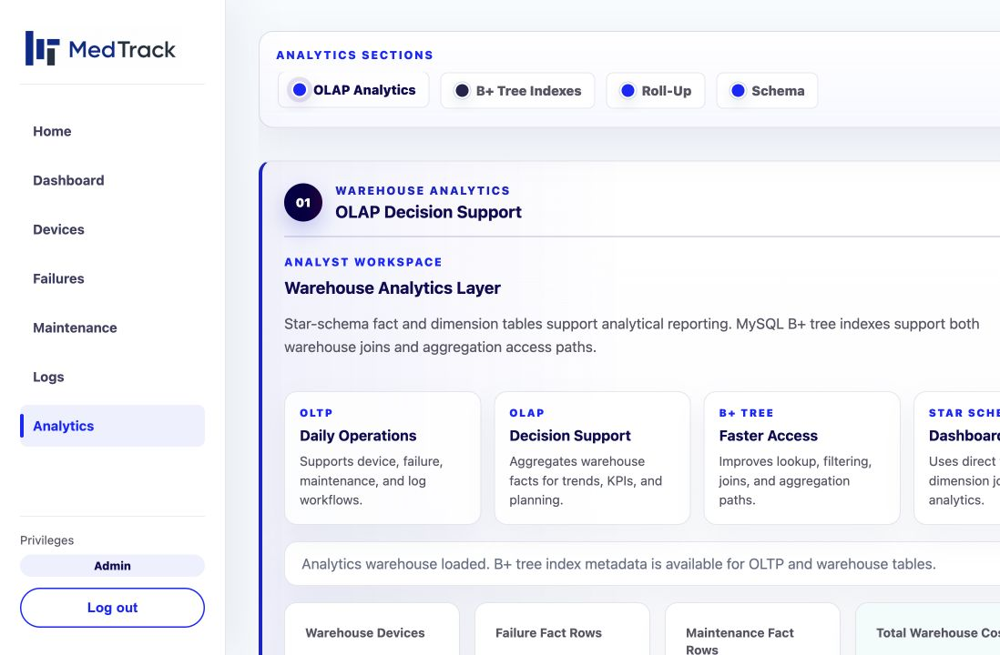

# MedTrack

[](https://github.com/yuzhihao1212/medtrack/actions/workflows/test.yml)

MedTrack is a project for tracking medical devices, failure reports, maintenance work, parts and operational logs. It addresses the split nature of hospital equipment data: structured records that need relational integrity live in MySQL, while variable event, sensor, note, alert and audit documents live in MongoDB. A Node.js/Express API and browser-based frontend bring both stores together for operational dashboards and analytical reporting.

## Highlights

- **Hybrid persistence:** [the relational schema](database/sql/schema.sql) stores devices, manufacturers, types, failures, maintenance, technicians, parts and users with keys and constraints; [the MongoDB collection design](database/nosql/collections.md) stores documents whose metadata or sensor readings vary by event and device type.
- **Normalised OLTP schema:** manufacturers and device types are lookup tables, maintenance parts use a junction table, and operational records reference their parent entities. See [schema.sql](database/sql/schema.sql) and the [dataset mapping](docs/dataset_to_database_mapping.md).
- **Index design and B+ tree inspection:** [indexes.sql](database/sql/indexes.sql) adds idempotent single- and multi-column indexes for risk, status, severity, cost and foreign-key access patterns. [btree_index_demo.sql](database/sql/btree_index_demo.sql) uses `SHOW INDEX` and `EXPLAIN` to demonstrate InnoDB index use without claiming synthetic benchmark results.
- **Database automation:** [triggers.sql](database/sql/triggers.sql) updates device risk after a failure insert, while [views.sql](database/sql/views.sql) provides high-risk, maintenance-dashboard and calculated risk-score projections.
- **Two RBAC layers:** JWT middleware enforces application roles in [backend/middleware/auth.js](backend/middleware/auth.js). [roles_grants.sql](database/sql/roles_grants.sql) separately demonstrates least-privilege database roles and grants for analysts, engineers and administrators.
- **OLAP modelling:** [olap_warehouse.sql](database/sql/olap_warehouse.sql) builds a star schema with device, technician and date dimensions plus failure and maintenance facts. [rollup_analysis.sql](database/sql/rollup_analysis.sql) adds `WITH ROLLUP` summaries, and [snowflake_variant.sql](database/sql/snowflake_variant.sql) provides a normalised dimension variant for comparison.
- **Document queries and aggregation:** [nosql_crud.js](database/nosql/nosql_crud.js) records CRUD examples, and [aggregations.js](database/nosql/aggregations.js) groups failures, notes, sensor readings, alerts and audit activity.
- **Traceable data preparation:** the original and cleaned CSVs are retained alongside [profiling reports](database/analysis/) and [documented cleaning decisions](docs/dataset_summary.md).

## Architecture



## Entity relationship model

This diagram is derived from [docs/erd.dbml](docs/erd.dbml) and [database/sql/schema.sql](database/sql/schema.sql).



MongoDB documents refer to the relational device record through `device_code`; this is intentionally a soft cross-database reference rather than a relational foreign key.

## Screenshots

These screenshots were captured from the running application with the repository's seeded local data. The full set and recapture notes are in [docs/screenshots/](docs/screenshots/README.md).



| Login | Role-aware home |
| --- | --- |
|  |  |

| Device inventory | Failure reports |
| --- | --- |
|  |  |

| Maintenance workflow | OLAP analytics |
| --- | --- |
|  |  |

## Quick start

### Prerequisites

- Node.js 18 or newer and npm
- MySQL 8 or a compatible MariaDB installation
- MongoDB
- The `mysql` command-line client on your `PATH`

### 1. Install dependencies

The root dependencies are used by the data loader; the backend has its own package manifest.

```bash
npm install
npm --prefix backend install
```

### 2. Configure the environment

```bash
cp .env.example .env
```

Set `MYSQL_PASSWORD` for your local database, change `MYSQL_PORT` if MySQL is not on port 3306, and replace `JWT_SECRET` with a long random value. The backend loads the root `.env`; an optional `backend/.env` can override it for older local setups. Both files remain ignored by Git.

### 3. Initialise the databases

Start MySQL and MongoDB, then run:

```bash
npm run init-db
```

The script rebuilds the `medtrack` MySQL schema, seeds the login accounts, creates views, indexes and triggers, imports the cleaned CSV into MySQL and MongoDB, and builds the OLAP tables and rollups. It is intended for disposable local development data: `schema.sql` drops existing MedTrack tables, and the loader replaces the `technician_notes` collection.

To initialise only the schema, accounts and SQL objects without loading the CSV or MongoDB notes:

```bash
SKIP_DATA_LOAD=1 npm run init-db
```

The database-level RBAC demonstration is deliberately separate because it creates database users and requires elevated privileges:

```bash
mysql -u root -p medtrack < database/sql/roles_grants.sql
```

### 4. Run the application

```bash
npm start
```

Open [http://localhost:3000](http://localhost:3000). For automatic restart during development, use `npm run dev`.

### Demo accounts

These development-only accounts come from [database/sql/seed_users.sql](database/sql/seed_users.sql):

| Username | Password | Role |
| --- | --- | --- |
| `bme_admin01` | `BmeAdmin@123` | `bme_admin` |
| `bme_engineer01` | `BmeEngineer@123` | `bme_engineer` |
| `bme_analyst01` | `BmeAnalyst@123` | `bme_analyst` |

Do not reuse these credentials outside local demonstration environments.

## Testing

Run the unit and integration tests with `npm test` after installing both sets of dependencies. Unit tests cover validation, response helpers, password hashing, JWTs and role middleware. Integration tests cover the seeded logins, access control, device CRUD and an OLAP summary against real MySQL and MongoDB. They report a skip when either database is unavailable locally.

```bash
npm test
```

The [GitHub Actions workflow](.github/workflows/test.yml) starts disposable MySQL and MongoDB services, runs `init-database.sh`, and sets `INTEGRATION_REQUIRED=1` so missing databases fail CI instead of being skipped.

## API overview

All successful API responses use `{ "success": true, "data": ... }`; errors use `{ "success": false, "message": ... }`. Except for health and login, routes require a bearer token. Role requirements below reflect the server middleware, which is the source of truth.

| Method | Path | Purpose | Authentication / role |
| --- | --- | --- | --- |
| GET | `/api/health` | Service health and timestamp | No |
| POST | `/api/auth/login` | Validate credentials and issue a JWT | No |
| GET | `/api/auth/me` | Return the current token identity | Any authenticated user |
| GET | `/api/dashboard` | Operational KPI summary | Any authenticated user |
| GET | `/api/dashboard/risk-ranking` | Ranked predictive-risk view | Any authenticated user |
| POST | `/api/dashboard/risk-alerts/sync` | Create missing MongoDB alerts for high-risk devices | Admin or engineer |
| GET | `/api/devices` | List devices with lookup details | Admin or engineer |
| GET | `/api/devices/high-risk` | List high- and critical-risk devices | Any authenticated user |
| GET | `/api/devices/manufacturers` | List manufacturer lookup values | Admin or engineer |
| GET | `/api/devices/device-types` | List device-type lookup values | Admin or engineer |
| GET | `/api/devices/:id` | Get one device | Admin or engineer |
| POST | `/api/devices` | Create a device | Admin |
| PUT | `/api/devices/:id` | Update a device | Admin |
| DELETE | `/api/devices/:id` | Delete a device and dependent operational rows | Admin |
| GET | `/api/failures` | List failure reports | Admin or engineer |
| GET | `/api/failures/summary` | Aggregate failures by device type | Any authenticated user |
| GET | `/api/failures/above-average-devices` | List devices above average failure count | Admin or engineer |
| GET | `/api/failures/:id` | Get one failure report | Admin or engineer |
| POST | `/api/failures` | Create a failure report | Admin or engineer |
| PUT | `/api/failures/:id` | Update a failure report | Admin or engineer |
| PATCH | `/api/failures/:id/status` | Update report status | Admin or engineer |
| DELETE | `/api/failures/:id` | Delete a failure report | Admin |
| GET | `/api/maintenance` | List maintenance records | Admin or engineer |
| GET | `/api/maintenance/dashboard` | Read the maintenance dashboard view | Admin or engineer |
| GET | `/api/maintenance/cost-by-manufacturer` | Aggregate maintenance cost by manufacturer | Admin or engineer |
| GET | `/api/maintenance/workload` | Summarise technician workload | Admin or engineer |
| GET | `/api/maintenance/technicians` | List technician lookup values | Admin or engineer |
| GET | `/api/maintenance/parts` | List part lookup values | Admin or engineer |
| GET | `/api/maintenance/pending` | List pending and in-progress maintenance | Admin or engineer |
| GET | `/api/maintenance/parts-usage` | Summarise part usage and estimated cost | Admin or engineer |
| GET | `/api/maintenance/:id/parts` | List parts for a maintenance record | Admin or engineer |
| GET | `/api/maintenance/:id` | Get one maintenance record | Admin or engineer |
| POST | `/api/maintenance` | Create a maintenance record | Admin or engineer |
| PUT | `/api/maintenance/:id` | Update a maintenance record | Admin or engineer |
| PATCH | `/api/maintenance/:id/status` | Update repair status | Admin or engineer |
| POST | `/api/maintenance/:id/parts` | Add a part to a maintenance record | Admin or engineer |
| PUT | `/api/maintenance/:maintenanceId/parts/:partId` | Update part quantity | Admin or engineer |
| DELETE | `/api/maintenance/:id` | Delete a maintenance record and its part links | Admin |
| DELETE | `/api/maintenance/:maintenanceId/parts/:partId` | Remove a linked part | Admin |
| GET | `/api/logs` | List device event logs | Admin or engineer |
| POST | `/api/logs` | Create an event log | Admin or engineer |
| PUT | `/api/logs/:id` | Update an event log | Admin or engineer |
| DELETE | `/api/logs/:id` | Delete an event log | Admin |
| GET | `/api/logs/notes` | List technician notes | Admin or engineer |
| POST | `/api/logs/notes` | Create a technician note | Admin or engineer |
| PUT | `/api/logs/notes/:id` | Update a technician note | Admin or engineer |
| DELETE | `/api/logs/notes/:id` | Delete a technician note | Admin |
| GET | `/api/logs/snapshots` | List sensor snapshots | Admin or engineer |
| POST | `/api/logs/snapshots` | Create a sensor snapshot | Admin or engineer |
| PUT | `/api/logs/snapshots/:id` | Update snapshot readings | Admin or engineer |
| DELETE | `/api/logs/snapshots/:id` | Delete a sensor snapshot | Admin |
| GET | `/api/logs/alerts` | List alert history | Admin or engineer |
| POST | `/api/logs/alerts` | Create an alert | Admin or engineer |
| PATCH | `/api/logs/alerts/:id/resolve` | Resolve an alert | Admin or engineer |
| DELETE | `/api/logs/alerts/:id` | Delete an alert | Admin |
| GET | `/api/logs/audit` | List audit records | Admin or engineer |
| GET | `/api/logs/aggregations/:type` | Run an allow-listed MongoDB aggregation | Admin or engineer |
| GET | `/api/olap/summary` | Warehouse KPI summary | Admin or analyst |
| GET | `/api/olap/maintenance-cost` | Maintenance cost drill-down | Admin or analyst |
| GET | `/api/olap/failure-cube` | Failure cube by device, time and severity | Admin or analyst |
| GET | `/api/olap/failure-trend` | Quarterly failure trend | Admin or analyst |
| GET | `/api/olap/risk-matrix` | Cross-analyse risk, priority, failures and cost | Admin or analyst |
| GET | `/api/olap/btree-indexes` | Return selected index metadata | Admin or analyst |
| GET | `/api/olap/maintenance-cost-rollup` | Manufacturer and device-type rollup | Admin or analyst |
| GET | `/api/olap/failure-rollup` | Year and quarter failure rollup | Admin or analyst |
| GET | `/api/olap/schema-comparison` | Compare star and snowflake dimensions and plans | Admin or analyst |

## Project structure

```text
.
├── backend/                 Express API, auth middleware and data-access models
│   ├── config/              MySQL pool and MongoDB connection
│   ├── middleware/          JWT authentication and role authorization
│   ├── models/              MongoDB collection operations
│   ├── routes/              REST endpoints for operational and OLAP features
│   ├── scripts/             Local development helpers
│   ├── utils/               Response, validation and authentication helpers
│   └── server.js            API and static frontend entry point
├── database/
│   ├── analysis/            Data profiling and summary CSVs
│   ├── cleaned/             Import-ready cleaned dataset
│   ├── nosql/               Collection design, examples and aggregations
│   ├── raw/                 Original source dataset retained for traceability
│   ├── sql/                 OLTP, indexes, views, triggers, RBAC and OLAP SQL
│   └── loader.js            CSV-to-MySQL and MongoDB loader
├── docs/                    Dataset notes, mapping, DBML and screenshot checklist
├── frontend/                Plain HTML, CSS, JavaScript and static assets
├── .env.example             Placeholder-only configuration template
├── init-database.sh         Ordered local database initialisation
├── LICENSE                  MIT license
└── README.md                Project overview and runbook
```

## Dataset and attribution

The retained source dataset contains 4,149 unique device records across 13 original columns, with purchase dates from 2013-04-13 to 2024-04-11. The project profile found no missing source values and identified 105 negative maintenance-cost values; the cleaned file keeps the raw amount for traceability and leaves the cleaned amount blank for those anomalies. Device type, manufacturer, country and maintenance-report distributions are recorded in [docs/dataset_summary.md](docs/dataset_summary.md).

The source is the [Medical Device Failure Dataset (Anonymized)](https://www.kaggle.com/datasets/antoinepierreno/medical-device-failure-dataset-anonymized) published on Kaggle by A. Pierreno. The downloaded copy is retained as [database/raw/medical_device_failure.csv](database/raw/medical_device_failure.csv).

## What I learned and design decisions

- Normalisation gives operational data enforceable relationships, while MongoDB avoids sparse relational tables for device-specific readings and event metadata.
- A hybrid database does not provide cross-store foreign keys. Using `device_code` as a soft reference keeps the SQL device record canonical but makes validation and consistency an application responsibility.
- Indexes should follow real filters, joins and sort patterns; `SHOW INDEX` and `EXPLAIN` make those choices inspectable without presenting unmeasured performance claims.
- A denormalised star dimension keeps analytical queries simple, while the snowflake variant reduces repeated dimension attributes at the cost of more joins.
- Application RBAC and database RBAC solve different problems. This app uses one configured database account at runtime, while the separate grants script demonstrates database-level least privilege.
- Keeping raw data, cleaned data and profiling outputs together makes anomaly handling reviewable instead of hiding it inside the loader.

## Possible improvements

- Add migration tooling so schema changes do not rely on rebuilding the development database.
- Validate MongoDB document shapes and add a reconciliation job for soft `device_code` references.
- Expand audit logging around SQL mutations; the current MongoDB audit model is present but not applied to every operational route.
- Use separate runtime database accounts or pools if database privileges need to mirror application roles end to end.
- Add a Docker Compose development environment after the initialisation lifecycle and readiness checks are covered by tests.

## My contribution

- I created the initial relational schema and seed data, then added SQL views, indexes, triggers and query examples, along with ERD and dataset-mapping documentation.
- I added the MongoDB collection design, sample documents, CRUD examples and aggregation queries.
- I built the first set of plain HTML and JavaScript pages for the dashboard, devices, failures, maintenance and logs, then worked on the public landing and login flow, role-aware home page and responsive navigation.
- I added predictive risk scoring to the dashboard and built the OLAP warehouse, API routes and dedicated analytics page.
- I created database initialisation scripts and later added automated unit and database integration tests, CI and the portfolio documentation.

## Project context and contributors

MedTrack began as a team project for the INF2003 database course (Group 23) and is being prepared here as a portfolio example of relational, document and analytical database design.

Contributors:

- Yu ZhiHao ([@yuzhihao1212](https://github.com/yuzhihao1212))
- Koh Wei Lun Kendrick ([@kthgoat](https://github.com/kthgoat))
- Nyi Khant Moe ([@mmmmm0e](https://github.com/mmmmm0e))
- Kareem Mohamed Arif ([@arifkareem](https://github.com/arifkareem))
- Isaac Lim Yee Shao ([@izaclimys-ux](https://github.com/izaclimys-ux))
- Darius Kan Teng Onn ([@Dkkan-dev](https://github.com/Dkkan-dev))

## License

Released under the [MIT License](LICENSE).
